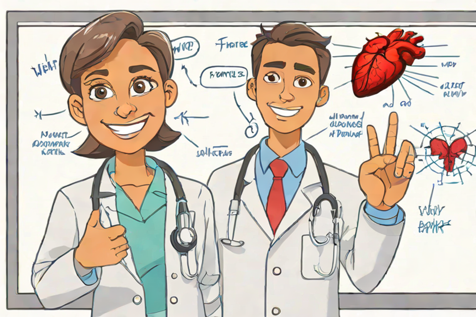

# 02 – SDXL-Turbo

| | |
|---|---|
| Model | `stabilityai/sdxl-turbo` (diffusers `AutoPipelineForText2Image`, diffusers 0.41.0, torch 2.14.1+cpu) |
| License | Stability AI Community License (originally "SAI-NC Community"); free for research / non-commercial and small commercial use under the license terms |
| Hardware | CPU only, 4 cores, 15 GB RAM |
| Precision | fp16 variant weights loaded as bfloat16 (UNet + text encoders); VAE in float32, latents decoded manually in fp32 |
| Steps | 4 |
| Guidance scale | 0.0 |
| Seed | 42 |
| Native size | 768x512 (3:2), upscaled to 960x640 with Pillow (bicubic) |
| Generation time | ~25 s for 4 steps + VAE decode (excluding model load/download) |
| Peak RAM | ~12.3 GB RSS |

## Notes on quality

- The CLIP text encoders truncate at 77 tokens, so the end of the prompt ("flat vector style with soft shading, bright classroom background, friendly educational mood, centered composition, even lighting") was dropped.
- Produced **two** students instead of one (a woman giving a thumbs-up and a man raising two fingers), so neither the single-subject framing nor the "pointing with a marker" pose is there; no marker visible.
- White coats and stethoscopes are present and fairly well drawn (stethoscopes slightly mangled at the chest piece).
- The heart is a fairly realistic red heart in the top right corner of the whiteboard, plus a smaller red blob in a diagram; no four chambers, no recognizable aorta / pulmonary arteries, no red/blue vessel coding.
- The whiteboard is covered with garbled pseudo-text labels ("Fraiee", "WeHt", etc.) — typical text garbage.
- Style is a decent bright cartoon look with sketchy lines rather than clean flat vector; some softness from upscaling 768x512 -> 960x640.
- Overall: very fast and cheerful-looking, but not anatomically usable for an educational MCQ illustration.
