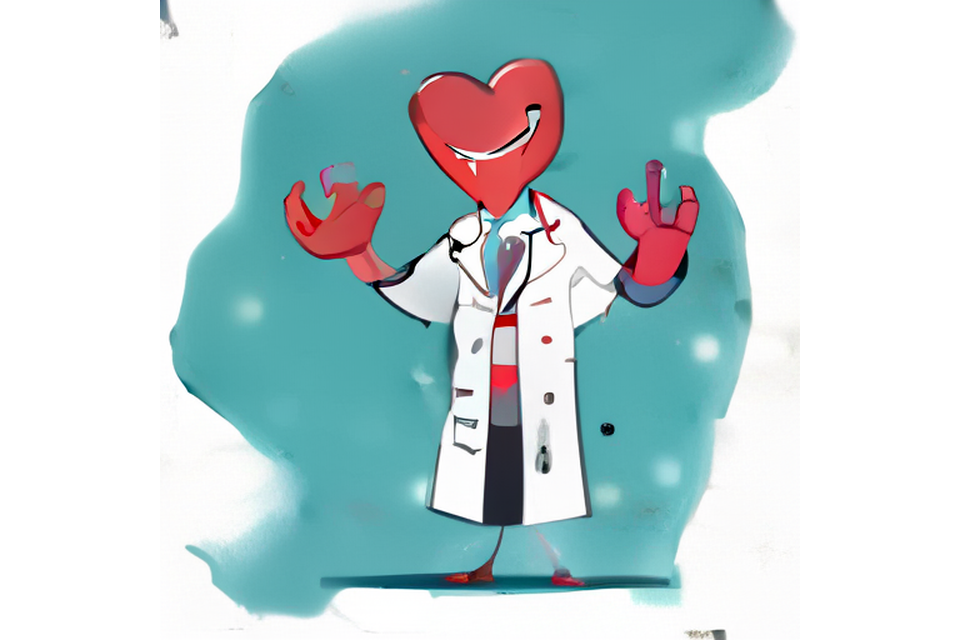

# 08 — aMUSEd 512 (`amused/amused-512`)

| | |
|---|---|
| Model | [`amused/amused-512`](https://huggingface.co/amused/amused-512) (diffusers `AmusedPipeline`, masked image model / VQGAN tokens, ~800M params) |
| License | OpenRAIL++ (`openrail++` on the model card) |
| Steps | 12 |
| Guidance scale | 10.0 |
| Seed | 42 (`torch.Generator("cpu")`) |
| Native size | 512x512 (square only) |
| Output size | 960x640: the full 512x512 image scaled to 640x640 (Lanczos) and centered on a white 960x640 canvas |
| Precision / device | float32, CPU only (4 threads), no offloading needed |
| Generation time | ~34 s for the 12 steps (~2.2 s/step); model load ~1 s from cache (first download ~50 s) |
| Peak RAM | ~4.6 GB RSS |
| Software | torch 2.14.1+cpu, diffusers 0.41.0, transformers 5.20.0 |

## How the 960x640 output was made

aMUSEd only works at its native square size, so I generated at 512x512. A center crop to 3:2 cut off the
character's head, so I used the full square on a white canvas instead. The source image's edges are mostly white, so
the white padding on the left and right blends in fairly well, although the left and right thirds of the frame are
empty.

## Quality notes (honest)

- **Prompt truncation:** the CLIP text encoder only reads 77 tokens. The prompt is 98 tokens, so it is cut off after
  "...clean flat". "vector style with soft shading, bright classroom background, friendly educational mood, centered
  composition, even lighting" never reached the model.
- **Heart / anatomy:** failed. There is no anatomical heart drawing. The model mixed up "heart" and "student" and drew a
  cartoon character whose **head is a red Valentine-style heart** with a grin. There are no chambers, no aorta, and
  no red and blue pulmonary vessels.
- **Whiteboard / marker / pointing pose:** missing. There is no whiteboard and no marker. The character holds both
  hands up in a vague "explaining" or jazz-hands pose, with odd, partly melted fingers. It does not point.
- **White coat + stethoscope:** partly right. The white lab coat is the clearest element, with buttons, a pocket and
  lapels. A dark stethoscope-like tube hangs around the neck.
- **Style / background:** a loose watercolor or painterly cartoon on a teal blob over white, not clean flat vector, and
  no classroom.
- **Text garbage:** none. No letters or pseudo-text appear.
- **Artifacts:** soft, blotchy VQ texture, white "dust" spots on the teal background, and malformed hands.

**Verdict:** fast and light on CPU, about half a minute per image with under 5 GB RAM. For this prompt it gives only a
generic "cartoon doctor" and a heart-headed mascot. It is not usable as an anatomy teaching illustration.
