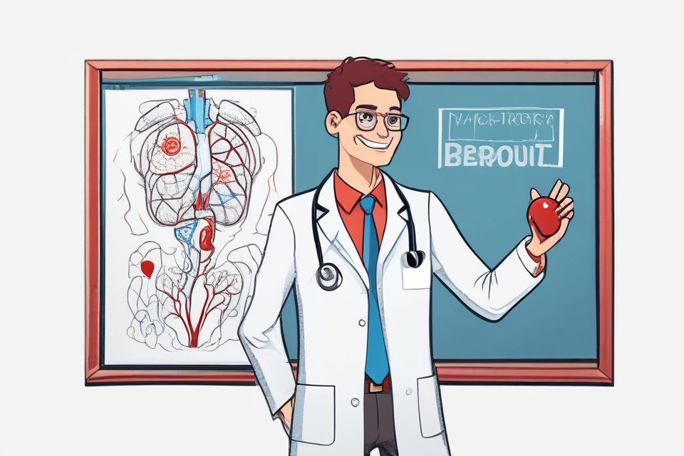

# 10 — SDXL-Lightning (4-step)

| Item | Value |
|---|---|
| Model | `ByteDance/SDXL-Lightning`: `sdxl_lightning_4step_unet.safetensors` on `stabilityai/stable-diffusion-xl-base-1.0` |
| License | SDXL-Lightning: OpenRAIL++ (`openrail++`); SDXL base 1.0: CreativeML Open RAIL++-M |
| Scheduler | EulerDiscreteScheduler, `timestep_spacing="trailing"` |
| Steps / guidance | 4 / 0 |
| Seed | 42 |
| Size | Generated natively at 960x640 (no resize or crop needed) |
| Hardware | CPU only (4 threads), float32, diffusers 0.41.0, torch 2.14.1+cpu |
| Generation time | ~58 s for 4 denoising steps (~14.6 s/step), 74 s including VAE decode; ~105 s total including model loading (weights already cached) |
| Peak RAM (process RSS) | ~14.2 GB |

## How it was run
Followed the diffusers example on the model card, with changes to fit 15 GB of RAM on CPU:
- The two text encoders (fp16 files upcast to fp32) encode the prompt first, then are freed.
- The Lightning UNet is created on empty weights and loaded with `assign=True`, upcasting tensors to fp32 one at a time, so only one copy is held in memory.
- Denoising returns latents. The UNet is then freed and the VAE decodes with tiling enabled.

The first attempt kept two copies of the UNet in memory and was killed silently during VAE decode. Peak RSS is still close to the 15 GB limit.

## Quality notes (honest)
- **Style / composition:** It matches the prompt's flat cartoon/vector style, centered, with clean lines and even lighting. The background is a plain white void with a framed board, not much of a "bright classroom".
- **Student:** Cheerful young man in a white coat with glasses, smiling. The **stethoscope** is present and rendered well around the neck.
- **Pose:** He does **not** point at the drawing with a marker. He holds a small red heart-shaped object in his raised hand and has his other hand in his pocket, and he faces away from the drawing. There is no open-hand explaining gesture.
- **Heart drawing:** The panel on the left shows a vaguely anatomical red/blue vascular figure: something like lungs or a torso with a central vessel and branching red arteries. It has **no recognizable four-chamber heart**, and it shows no clear aorta or pulmonary arteries. Red and blue are present, but the anatomy is wrong.
- **Text garbage:** Yes. Nonsense text "BEROUIT" and a scribbled label box appear on the board.
- **Overall:** Very fast for SDXL on CPU and a pleasant illustration, but it is not usable as an accurate anatomy teaching image without editing.
